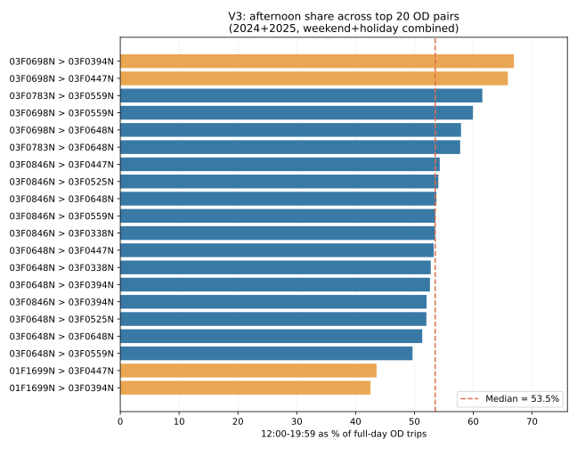

# V3_LITE：週末／連假 OD + 四支 VD，日期與缺值稽核

本研究版本以國道 3 號北向龍潭→大溪為對象，原 V2 原檔不修改。`build_v3_lite_holiday.py` 產生新的 **V3_LITE_HOLIDAY**：

- 日期：2024–2025 年、`DayType ∈ {WEEKEND, LONGHOLIDAY}`；不納入 `WEEKDAY`、`STANDALONEHOLIDAY` 作為主要分析樣本。**正式 V3 全程使用假日完整 24 小時；沒有 14–20 點子時段與 `is_focus_window` 欄位。**
- VD：只納入 `K69.510`（0.0417）、`K65.990`（0.4600）、`K63.990`（0.3600）、`K61.670`（0.1383）。`K61.000` 不進入 V3 或 Y。
- VD 原始欄位：`TargetTime,VDID,Speed,Occupancy,VDType`；負速度、缺速度與缺測站列分開標註。**一至四站有效都計算 Y；四站全缺才 Y=NA。**
- 令 `O_t` 為有效站集合：`C_weighted = [Σ_(j∈O_t) w_j 1(Speed_j < 40)] / [Σ_(j∈O_t) w_j]`；`Y=0`（`C=0`）、`Y=1`（`0<C<c`）、`Y=2`（`C>=c`），目前預設 `c=0.50`。**只要一站有效就計算，沒有三站、75% 的限制**；但輸出有效站數和有效權重供敏感度分析。

## A. Windows PowerShell：取得程式

Windows 上沒有 `git` 指令時，直接下載 GitHub 原始碼。**注意 Git 路徑是 `10_OD-analysis`（連字號），你本機程式夾是 `10_OD analysis`（空格）。**

```powershell
cd "D:\統計實務\M06B_project"
New-Item -ItemType Directory -Force ".\10_OD analysis" | Out-Null
Invoke-WebRequest `
  -Uri "https://raw.githubusercontent.com/aishanchung/Statistical-Practice/main/10_OD-analysis/build_v3_lite_holiday.py" `
  -OutFile ".\10_OD analysis\build_v3_lite_holiday.py"
```

使用原本 `.venv`，依賴為 `duckdb pandas numpy`。不需要重新安裝 scikit-learn。

## B. 稽核模式（已有 2026-11-04 輸出，通常不必重跑）

```powershell
& ".\.venv\Scripts\python.exe" ".\10_OD analysis\build_v3_lite_holiday.py" `
  --od-input "D:\統計實務\Data\V2_LITE_WEATHER\V2_parts" `
  --vd-input "D:\統計實務\M06B_project\07_VD\VD_N3_N_2024_2025_LITE.parquet" `
  --output "D:\統計實務\M06B_project\outputs\V3_LITE_holiday_audit" `
  --audit-only `
  --threads 4 --memory-limit 4GB
```

`--audit-only` **仍會完整掃描 OD 日期並核對所有四站預期五分鐘格**，但不輸出旅次級 V3 與 OD-pair 五分鐘量，省磁碟與時間。

已檢查 `V3_LITE_holiday_audit.zip`（91 個 OD 分檔、1 個 VD 檔）；依 **24 小時全日**統計：

| 年份 | 納入假日 | 預期 5 分鐘時段 | 四站全部有效時段 | **至少一站有效、可計算 Y** | **正式 Y 缺失率** | 舊版嚴格四站缺失率 |
|---|---:|---:|---:|---:|---:|---:|
| 2024 | 113 | 32,544 | 30,167 | 31,024 | **4.67%** | 7.30% |
| 2025 | 117 | 33,696 | 32,527 | 33,423 | **0.81%** | 3.47% |

特別注意：2024/11/30、12/01、12/07、12/08 四站整天速度無效；2024/11/24 四站有 21 小時 55 分鐘連續缺失；2025/03/16 四站有 16 小時 25 分鐘連續缺失；2025/05/10–11 主要為 K61.670 長時間無效。報表中 `row_absent_bins=0`，缺失都落在 `invalid_speed_bins`；有列不代表有可用速度。**保留這些日期的 OD 記錄，不對缺 VD 的時段製造 Y=0；模型訓練再按有效 Y 篩選。**

## C. 正式產生 V3（24 小時，不建立下午標記）

```powershell
& ".\.venv\Scripts\python.exe" ".\10_OD analysis\build_v3_lite_holiday.py" `
  --od-input "D:\統計實務\Data\V2_LITE_WEATHER\V2_parts" `
  --vd-input "D:\統計實務\M06B_project\07_VD\VD_N3_N_2024_2025_LITE.parquet" `
  --output "D:\統計實務\M06B_project\outputs\V3_LITE_holiday_full" `
  --c 0.50 `
  --threads 4 --memory-limit 4GB
```

時間視硬碟及 91 個 OD 分檔容量而定；掃描 4,500 萬多筆 OD 時不會一次載入 pandas。最費時／佔空間的是 `V3_LITE_OD_TRIPS.parquet`。只需要聚合 OD 與四站資料時加 `--skip-trip-level`。

### C.1 已經建立完整 V3？**只重新產生 Y，不必再跑 91 個 OD 分檔（建議）**

先下載輕量修正程式到本機，然後指定先前完整 V3 的輸出資料夾：

```powershell
Invoke-WebRequest `
  -Uri "https://raw.githubusercontent.com/aishanchung/Statistical-Practice/main/10_OD-analysis/rebuild_v3_y_available.py" `
  -OutFile ".\10_OD analysis\rebuild_v3_y_available.py"

Invoke-WebRequest `
  -Uri "https://raw.githubusercontent.com/aishanchung/Statistical-Practice/main/10_OD-analysis/build_v3_lite_holiday.py" `
  -OutFile ".\10_OD analysis\build_v3_lite_holiday.py"

& ".\.venv\Scripts\python.exe" ".\10_OD analysis\rebuild_v3_y_available.py" `
  --existing-v3 "D:\統計實務\M06B_project\outputs\V3_LITE_holiday_full" `
  --output "D:\統計實務\M06B_project\outputs\V3_LITE_holiday_Y_available" `
  --c 0.50 --threads 4 --memory-limit 4GB
```

`V3_LITE_holiday_Y_available/V3_Y_5MIN.parquet` 是新的正式 Y，`V3_focus_date_coverage.csv` 和缺失摘要也會依新規則更新。原目錄中的 OD 旅次、OD-by-pair、舊 Y、四站 VD **全部保留不覆蓋**。後續模型請指定**新 Y 的路徑**，OD 仍用原本的 V3 OD 輸出。

## D. 缺值與原始日期稽核輸出

| 輸出 | 重點 |
|---|---|
| `V3_calendar_all_dates.csv` | 2024–2025 **所有應有日曆日期**；DayType、來源、OD 該日是否沒有旅次、是否納入 V3 |
| `V3_calendar_focus_dates.csv` | 真正納入分析的日期清單，含週末無 OD 旅次的日期 |
| `OD_daytype_counts.csv`、`OD_daytype_conflicts.csv` | 同一日期各個 DayType 的筆數及衝突（不默默當成一致） |
| `OD_dates_needing_calendar_review.csv` | OD 完全沒資料的平日、DayType 衝突日、週末標錯日；**優先人工檢查** |
| `VD_missing_summary.csv` | 依年、WEEKEND / LONGHOLIDAY、全天 24 小時；四站有效率及單／雙／三／四站同時缺失率；另列 `Y_valid_bins`、`Y_unavailable_pct` |
| `VD_missing_by_date.csv` | 精確到日期的缺值比例與缺一支至缺四支的五分鐘格數 |
| `VD_missing_by_date_station.csv` | 每日**每支 VD 公里位置**的 288 預期格、有效／不存在／無效速度／缺值％ |
| `VD_missing_by_station_summary.csv` | 依站、年、DayType 的全日缺值比例 |
| `VD_missing_by_month_station.csv` | 依月、站、DayType 的全日缺值比例 |
| `VD_missing_runs_by_station.csv` | **缺測位置＋連續起訖時間＋分鐘數＋原因**，涵蓋完全沒有列的時間 |
| `VD_missing_runs_joint.csv` | **同時缺失哪幾支 VD**、連續多久，完整區分單站、多站、全站 |
| `VD_duplicate_station_time.csv` | 重複測站時間檢核；若有重複，程式會停止以免模糊平均 |
| `V3_focus_date_coverage.csv` | 逐日期：有效 Y 的 5 分鐘格比例、所有四站同缺、OD 零旅次格比例 |
| `V3_LITE_VD_4SITES.parquet` | 四站 × 全部預期五分鐘格；缺值保留 `MissingStatus` |
| `V3_Y_5MIN.parquet` | 有效 VD 重正規化的 Y、C、`n_valid_vd`、`weight_coverage`、`used_partial_vd`、同格 OD 旅次數（僅診斷）；不含時間窗標記 |
| `V3_LITE_OD_TRIPS.parquet` | 正式模式：篩選過的原 OD 旅次；移除 K61.000 相關速度／佔有率欄位 |
| `V3_OD_5MIN_BY_PAIR.parquet` | 正式模式：依 BottleneckTime/起訖門架/車種每五分鐘旅次數 |
| `V3_run_config.json` | 參數、空間權重、`time_scope=full_day_24h`、分析日期數 |

注意：VD 預期資料分母為 **每個假日每站 288 個 5 分鐘格**；不使用「實際存在的資料列數」當分母。`VD_missing_summary.csv` 中 `missing_pct` 分母為四站所有格，`Y_unavailable_pct` 分母為時間格、且只計算四站全缺的時段；`four_vd_incomplete_pct` 是純資料品質診斷，不是正式 Y 缺值率。正式 V3 僅有 `scope=full_day`；原稽核報表中的 `focus_window` 是舊輸出，**正式版不再產生**。

`ROW_ABSENT` = 應有測站／時間資料列不存在；`INVALID_SPEED` = 列存在但速度負值或空值。兩者都不進入**當下有效站的分子與分母**，只有四站全缺才無法計算 Y；目前不做速度補值。`VDType` 原值保留，可後續辨別官方缺值標記。**某個五分鐘格 OD=0 筆不能直接認定為 OD 缺檔**；OD 沒有預期的固定旅次數基準。

## E. 重要缺檔限制及日曆修正

`DayType` 存在於 OD V2，不存在於 VD 原檔。程式先對每個日期統計 OD 的標籤，以最多票為主，平票時參考週末規則；無 OD 的六、日仍納入 WEEKEND。但**某個平日如果 OD 也完全缺檔，它是否原屬 LONGHOLIDAY 無法從 V2 推回來**，在 `OD_dates_needing_calendar_review.csv` 會警告。這時請提供經官方日期核對的 CSV：

```csv
Date,DayType
2024-02-09,LONGHOLIDAY
2024-02-10,LONGHOLIDAY
```

以上僅為格式示例，日期請另行核對原始行政機關行事曆、假日實際調整。執行時加上：

```powershell
  --calendar-csv "D:\統計實務\Data\confirmed_holiday_calendar_2024_2025.csv"
```

同一天如果出現多種 OD `DayType`，原筆數全部保留於報表；CSV 覆寫日曆標籤優先，讓全日分類一致。所有輸出只放在指定 `--output`；**不會刪除或改動 V2 原始檔**。

## F. 預測／研究倫理

1. V3 日期篩選與原本對**全年 OD** 做出的探索性分群是兩個階段。若要針對假日重新分群，需另訓練及比較群組穩定性；不能說全年最佳 K 就是假日預測最佳 K。
2. 正式驗證仍建議 2024 訓練、2025 測試，絕不可利用 2025 的 Y 反推挑選 2024 模型所用的 `c` 或分群規則。
3. `BottleneckTime` 5 分鐘 OD 歸屬通常是**事後回溯**；在真正預測未來 Y 時不可偷用尚未完成旅次的 OD 資訊。


## G. EDA（V3_LITE，2026-11-05）

> **狀態：先前 V3 完整 EDA、OD 配對層級的 2024／2025 週末／連假特徵細查均已完成；2024 OD 分群 pilot 已執行 64 個候選。** 本節只呈現實際已算過的資料，不把觀察寫成預測績效或氣象因果結論。

### G.1 範圍、總量與日期

- V3 僅含 2024–2025 的 WEEKEND／LONGHOLIDAY，完整 24 小時，累計 **230 天、16,068,709 筆 OD 旅次**。OD 原始記錄與 Y 的 OD 合計已檢查一致。
- 2024：WEEKEND **98 天、6,787,300 筆**；LONGHOLIDAY **15 天、1,171,680 筆**。
- 2025：WEEKEND **86 天、5,876,665 筆**；LONGHOLIDAY **31 天、2,233,064 筆**。
- 已修正假期階段：**2024-01-01 是 2023-12-30～2024-01-01 連假的最後一天（last），不是 single**；跨年連假不能只因 V3 起始日為 2024-01-01 就切斷。

### G.2 OD 數量長尾與樣本篩選

- 全期共 **11,740** 組有旅次的 OD 配對（以 GantryO × GantryD 為單位）。
- 前 **100** 大 OD 約占全期 **57.05%** 旅次；前 **500** 大約占 **85.39%**。因此後續不宜直接把每組 OD 的總量當成與時間型態相同權重的特徵。

| 2024 最少旅次／OD | 選入 OD 數 | 2024 旅次涵蓋率 | 2025 旅次涵蓋率 |
|---:|---:|---:|---:|
| 100 | 2,285 | 98.89% | 96.86% |
| **300（暫定主分析）** | **1,493** | **97.08%** | **95.07%** |
| 500 | 1,180 | 95.56% | 93.55% |

選入門檻只用 2024 資料決定；2025 僅用於外部穩定性與後續預測檢驗。

### G.3 時間分布與連假需求

| 年份 | WEEKEND 平均每日 OD 旅次 | LONGHOLIDAY 平均每日 OD 旅次 | 連假增幅 |
|---|---:|---:|---:|
| 2024 | 69,258 | 78,112 | 約 +12.8% |
| 2025 | 68,333 | 72,034 | 約 +5.4% |

這是**整體平均每日**旅次，非每一組 OD 的變化；不能用假日總筆數直接比較，因兩種日型天數不同。

已完成的前 20 大 OD 合併年度／日型逐時 EDA（2024+2025，週末+連假）發現：

- **12:00–19:59** 旅次占各 OD 全天比例約 **42.5%–66.9%**，中位數 **53.5%**。
- **18/20** 組 OD 的單小時尖峰落在 13:00–17:00，另 **2/20** 組尖峰為 22:00。
- 例：`01F1699N → 03F0394N` 的下午占比約 **42.5%**、尖峰 22:00；`03F0698N → 03F0394N` 約 **66.9%**、尖峰 17:00。
- 這些觀察初步支持**OD 之間的時間分布存在異質性**，但前 20 大且合併年度／日型的結果不能直接代表全部 OD，也不能證明連假效果。



> 圖中每個 OD 的分母為該 OD 全日旅次數；這是兩年與兩種日型合併的探索性比較，不能直接解讀為連假效果。

### G.4 車種、距離、天氣與 Y 資料品質

- `VehicleType` 31、32 為主要代碼；沒有經官方代碼表驗證之前，不應自行替代碼指定車種語意。
- `TripLength` 全期中位數約 **72.78**、第 95 百分位約 **268.88**（原程式自動推斷 km；正式解讀須再核對原始單位）。距離可能與 OD 的起終門架高度相關，因此與門架空間特徵有重複風險。
- 既有天氣 EDA 顯示不同年份、日型的降雨分布可能不同；`precipitation > 0` 很敏感，不能單憑圖推論「2025 旅次較少是因為下雨」。天氣留作後續時變預測共變數，不直接當成固定 OD 群組特徵。
- 四支 VD 任一站有效即計算 Y；全站缺時 Y=NA。2024 假日 Y 不可用比例約 **4.67%**，2025 約 **0.81%**。本階段純 OD 分群 EDA **不使用 Y 作為特徵**。

### G.5 已完成的 OD-pair 小型 EDA（2024／2025）

程式：[**v3_od_quick_eda.py**](v3_od_quick_eda.py)。沿用 V3 日曆的 `DayType`，**忽略冗餘的 `V3_DayType` 欄**；以 `BottleneckTime` 描述 OD 旅次，完整 24 小時：

1. **OD 24 小時型態**：每組 OD 在 WEEKEND／LONGHOLIDAY 各小時的比例熱圖與前五大 OD 對照。
2. **連假效應**：六個 4 小時區塊的連假減週末占比（百分點）；同 OD 日型分布的 JS divergence。
3. **車種／距離**：2024 車種占比與 TripLength 原始中位數／四分位數。
4. **跨年穩定**：各 OD 的 2024 vs 2025 六區塊分布 JS divergence。兩邊各至少 30 筆才計算，以免小樣本誤判。
5. **涵蓋率**：2024 年每 OD ≥100／300／500 筆，列出 2024、2025 的旅次涵蓋比例。

已取得 `README_results.md`、8 份 EDA CSV 及 A–D 四張 PNG 圖；本節結果摘要與完整分群進度見下方 H 節。

本機 PowerShell（假設檔案保存在 `10_OD analysis`，不是 Git 的連字號目錄）：

```powershell
Invoke-WebRequest `
  -Uri "https://raw.githubusercontent.com/aishanchung/Statistical-Practice/main/10_OD-analysis/v3_od_quick_eda.py" `
  -OutFile "D:\統計實務\M06B_project\10_OD analysis\v3_od_quick_eda.py"

& "D:\統計實務\M06B_project\.venv\Scripts\python.exe" `
  "D:\統計實務\M06B_project\10_OD analysis\v3_od_quick_eda.py" `
  --input "D:\統計實務\Data\V3_LITE\V3_LITE.parquet" `
  --calendar "D:\統計實務\Data\V3_LITE\V3_Y_5MIN.parquet" `
  --output "D:\統計實務\Data\V3_LITE\od_quick_eda" `
  --min-trips 300 --threads 4
```

若尚未安裝依賴，先執行 `python -m pip install duckdb pandas numpy matplotlib`。**連假 first／middle／last 此次不拆成大量 OD 特徵**，先確認樣本數與 2024／2025 型態穩定，再決定是否納入。

V3 OD-pair 特徵 EDA 與第一輪 64 組無監督分群已執行；壅塞預測與預測最佳 K 尚未完成。

資料更新位置：[V3 Google Drive](https://drive.google.com/drive/folders/1lwLzrDoav_PEFxuQTkq0bdHHh_OBjybR?usp=drive_link)。


## H. OD-pair EDA 數值結果與分群 pilot（2026-11-05 更新）

- [完整 EDA 解讀、候選特徵、64 組 V3 分群結果與未完成的預測驗證](V3_OD_CLUSTER_PILOT_20261105.md)。
- 2024 OD ≥300 筆，共 **1,493 OD**；2024 全量資料建立固定 OD 群組。輸出全部 **4 特徵組 × 4 方法 × K=2–5 = 64 組**，皆有 OD 標籤與群組特性表。
- 假日對比：2024 每組 OD 的「連假−週末」比例差，中位數 00–03 時 **+4.72 pp**、16–19 時 **−4.91 pp**。這些是相對占比，不可解讀為絕對車流下降。
- 2024 OD 距離 vs 連假/週末每日需求比的 Spearman 相關約 **0.666**；2025 對應約 **0.621**，支持把距離當作待比較特徵，不能直接認定因果。
- 2024 vs 2025 週末日內分布的 JS divergence 中位數 **0.0027**；連假 **0.0083**；2024 週末 vs 連假 **0.0232**。兩年連假天數與組成不同，解釋須謹慎。
- 探索性分群 F1/Sparse/K=2 Silhouette **0.349**；但**不表示對壅塞預測最好**。示例 F3/K-means/K=3 的三群 OD 數為 340／729／424，各群可依距離、時段及連假需求增幅解釋。
- 本次只跑無監督分群，**尚未測試 Logistic Regression／XGBoost／LightGBM 的 B0／B1／B2 2024 時序驗證與 2025 外部測試**。

結果檔：[`v3_method_scores.csv`](results/v3_od_cluster_pilot/v3_method_scores.csv)、[`v3_cluster_profiles_all.csv`](results/v3_od_cluster_pilot/v3_cluster_profiles_all.csv)、[`v3_od_labels_wide.csv`](results/v3_od_cluster_pilot/v3_od_labels_wide.csv)。程式：[`v3_od_cluster_pilot.py`](v3_od_cluster_pilot.py)。原始旅次級 V3 Parquet 不放 GitHub。
