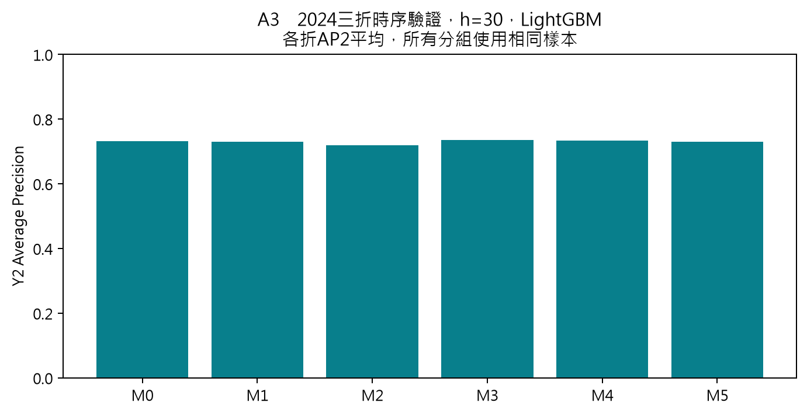
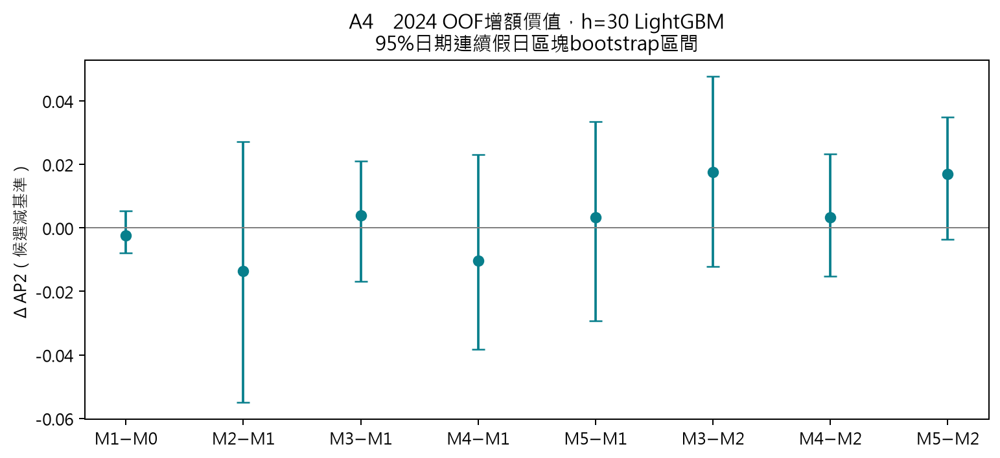
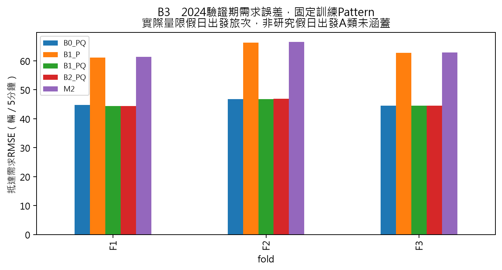
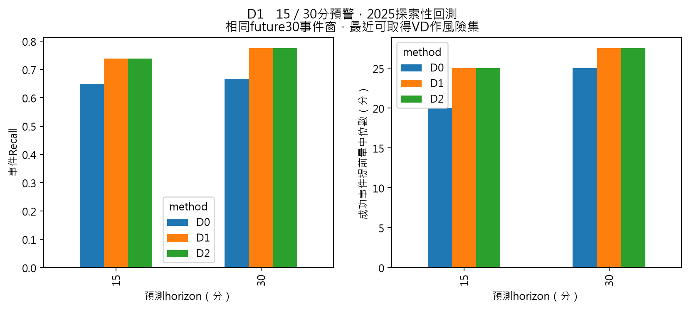

# 2026/11/22 統計實務：工作包 0–E

這是已執行的受控 Pilot 成果封存，基底為 main `98b742f759bdf30e444f073107dbe8bd35e3c3d5`。主要h=30分鐘，h=15敏感度；2024三折時序驗證選模，2025探索性回測。不是新的2026獨立測試。

## 先讀這四份

- [研究結論與可供進度報告的結果表](research_conclusions_zh.md)
- [詳細研究定義與公式](../../experiments/congestion_2026/METHODS_zh-TW.md)
- [資料schema、介面與重現依賴](../../experiments/congestion_2026/DATA_CONTRACT.md)
- [實際完成、測試與未完成項目](acceptance_report.md)

## 主要證據

| 問題 | 對應公開結果 |
|---|---|
| 297／341／347個O為何不同 | [O母體稽核](tables/o_universe_audit.csv) |
| ALL／Top20／K5/10/20下游預測 | [逐折完整表](tables/model_comparison_all.csv)、[2024選模平均](tables/selection_2024_only.csv) |
| 群別、大小、特徵與穩定性 | [O群別](tables/kmeans_cluster_assignments.csv)、[群摘要](tables/cluster_profile.csv)、[ARI](tables/clustering_stability.csv) |
| 相對基準的成對改善 | [逐折差異與OOF日期區塊區間](tables/incremental_gain_vs_baselines.csv) |
| N/P/Q有沒有改善需求／分類 | [需求誤差](tables/historical_demand_error.csv)、[分類消融](tables/npq_ablation_metrics.csv)、[配對區間](tables/npq_paired_uncertainty.csv) |
| Y1改善及Y2代價 | [C0/C1/C2比較](tables/y1_model_comparison.csv)、[有效VD診斷](tables/y1_by_vd_coverage.csv) |
| 15／30分類共同樣本 | [共同起點指標](tables/horizon_common_metrics.csv) |
| 事件命中、誤報及複核 | [事件評估](tables/event_detection_metrics.csv)、[日期區塊區間](tables/event_bootstrap.csv)、[複核負擔](tables/rejection_workload.csv) |
| 舊九組可否重算 | [九組重現](tables/legacy_nine_model_reproduction.csv) |
| 資料與實驗版本 | [可攜manifest](tables/input_manifest_portable.csv)、[公開run_config](run_config_public.json)、[凍結選模](frozen_selection.json) |

## 圖表與Dashboard

所有研究圖均附PNG、SVG，見 [figures](figures)。以下可直接放進進度報告：

Dashboard為歷史回放，使用真實保存機率，沒有即時串流：[首頁截圖](dashboard/overview_h30.png)、[成功事件](dashboard/successful_event.png)、[漏報事件](dashboard/missed_event.png)。啟動與操作見 [dashboard/README.md](../../dashboard/README.md)。截圖中的future truth只有啟用事後答案才顯示，不是當時輸入。

## 公開邊界與限制

完成120個配置／折別、保存1,501,986筆逐配置機率於本機；公開這些數量不代表公開逐筆資料。原始旅次、全量機率、權重、cache、大型Q與警報明細保留本機，不附GitHub。CSV皆為彙總、群別或指定案例資訊；可攜manifest移除個人電腦根路徑。

早期連假r樣本不足，本輪分群不含r；未執行新的XGBoost網格、C3二階段或2026驗證。VD發布延遲10分鐘仍是代理假設，非營運驗證。K5略優但區間跨零，暫保留Baseline；P+Q改善抵達需求對齊尚未穩定改善分類；成本決策提高命中也增加誤報，Rejection不是成功預警。

11/12舊報告及原成果保留，新舊事件風險集不同，請勿直接混合事件命中數。此頁的M0–M5為本輪配置代號，詳見方法文件。

驗收與研究摘要中的「未推送GitHub」描述的是2026/11/22分析完成當下的狀態。本成果頁及程式依後續使用者授權另行發布；原始資料與大型本機產物仍不公開。

### 各折建模用 O 特徵表

完整O特徵與三種r原始／平滑比值保存在 [F1](tables/o_features_F1.csv)、[F2](tables/o_features_F2.csv)、[F3](tables/o_features_F3.csv)、[EXP2025](tables/o_features_EXP2025.csv)。這些表各有自己的history_before與complete_months，不可回填較早預測列。雖保存r供診斷，本輪K-means未使用r。
