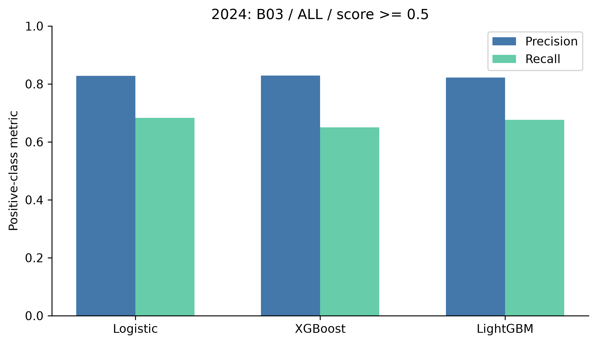
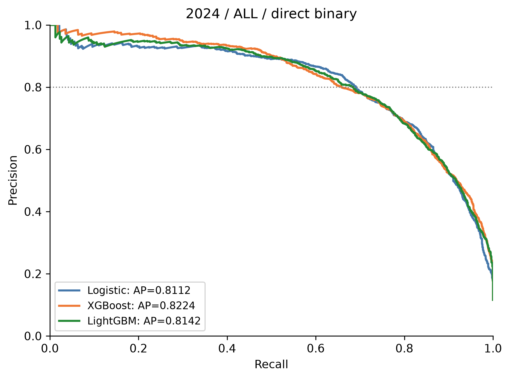
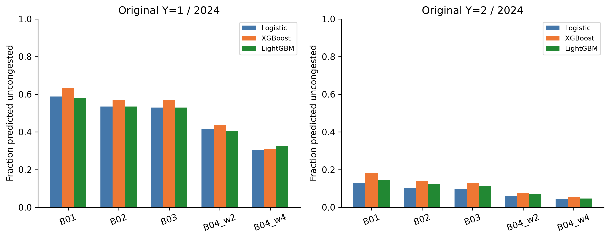
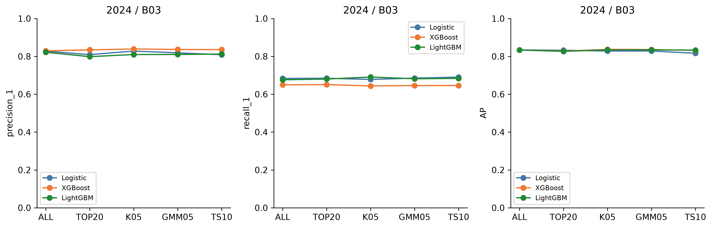
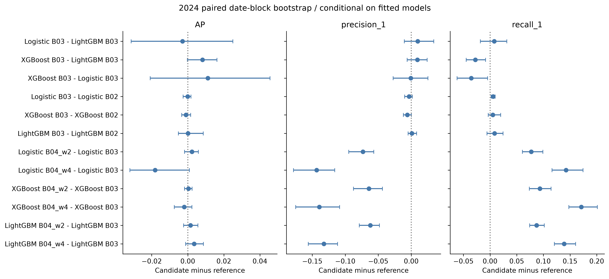
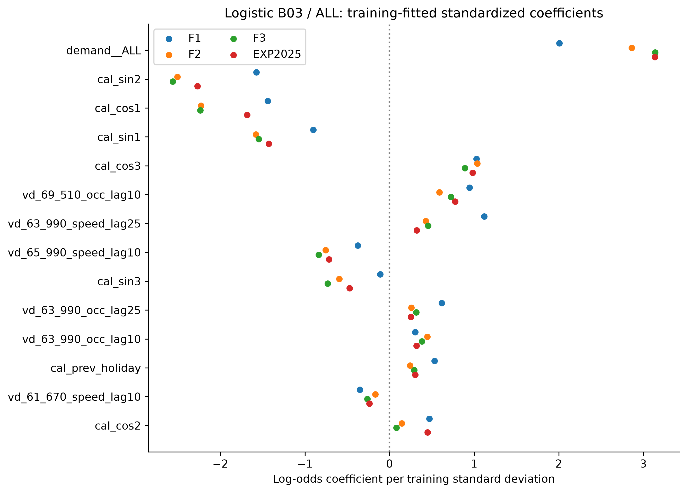

# 二元壅塞分類器比較 實際研究結論

本輪已完成三種分類器、五種O分組、五種策略及四評估期，共300個預測配置。LightGBM100份既有預測完全沿用；Logistic／XGBoost共160個訓練checkpoint，其中12個Logistic三分類舊機率經重現後重用，其餘148個新模型；B01與B02共用同一個三分類模型，沒有重複為兩者訓練。全部使用既有.venv，不掃M06B，也沒有調參或更動Y。smoke及同目錄續跑通過，原binary_congestion_pilot及未提交成果保留。

## 1 哪種分類器較好

沒有跨指標全面勝出的分類器。預先指定ALL／B03／0.5時，2024三折平均AP分別為Logistic 0.83399、XGBoost 0.83340、LightGBM 0.83359，差距很小；Logistic的precision與recall略高，XGBoost在0.5較保守。

| algorithm | precision_1 | recall_1 | f1_1 | AP | false_alarm_bins_per_day |
|---|---|---|---|---|---|
| lightgbm | 0.8219 | 0.6764 | 0.7405 | 0.8336 | 4.6540 |
| logistic | 0.8278 | 0.6833 | 0.7483 | 0.8340 | 4.4611 |
| xgboost | 0.8294 | 0.6497 | 0.7278 | 0.8334 | 4.1737 |

配對區間以下採2024合併OOF，不是上表三折平均。ALL/B03的合併AP分別為0.81122／0.82238／0.81418；XGBoost−LightGBM的AP差+0.00819，95%區間[−0.00021,0.01616]，仍跨零。Logistic−LightGBM的AP差−0.00297，區間[−0.03140,0.02503]。XGBoost固定0.5的recall較低，但不能因此說其整體排序必然較差。AP跨折合併還受折間分數尺度影響，主表與合併OOF均保留。

| algorithm | reference_algorithm | metric | difference | lower_95 | upper_95 |
|---|---|---|---|---|---|
| logistic | lightgbm | AP | -0.0030 | -0.0314 | 0.0250 |
| logistic | lightgbm | precision_1 | 0.0099 | -0.0106 | 0.0341 |
| logistic | lightgbm | recall_1 | 0.0078 | -0.0182 | 0.0313 |
| xgboost | lightgbm | AP | 0.0082 | -0.0002 | 0.0162 |
| xgboost | lightgbm | precision_1 | 0.0093 | -0.0063 | 0.0241 |
| xgboost | lightgbm | recall_1 | -0.0275 | -0.0448 | -0.0084 |
| xgboost | logistic | AP | 0.0112 | -0.0209 | 0.0456 |
| xgboost | logistic | precision_1 | -0.0006 | -0.0273 | 0.0253 |
| xgboost | logistic | recall_1 | -0.0353 | -0.0617 | -0.0047 |

## 2 直接二元重訓是否都有額外效益

不是。ALL的B03−B02合併OOF AP差：Logistic −0.00009、XGBoost −0.00102、LightGBM +0.00012，三者區間均跨零。固定0.5的recall增量約0.57／0.52／0.83個百分點；Logistic本輪區間約[0.19,0.95]個百分點，但幅度小、precision略降，不能將此小型決策改善等同排序全面提升。不同O分組另列完整配對結果，不以單一配置宣布所有分類器均應重訓。

| algorithm | metric | difference | lower_95 | upper_95 |
|---|---|---|---|---|
| logistic | AP | -0.0001 | -0.0026 | 0.0018 |
| logistic | precision_1 | -0.0034 | -0.0099 | 0.0018 |
| logistic | recall_1 | 0.0057 | 0.0019 | 0.0095 |
| xgboost | AP | -0.0010 | -0.0034 | 0.0016 |
| xgboost | precision_1 | -0.0059 | -0.0119 | 0.0002 |
| xgboost | recall_1 | 0.0052 | -0.0034 | 0.0200 |
| lightgbm | AP | 0.0001 | -0.0052 | 0.0086 |
| lightgbm | precision_1 | 0.0009 | -0.0048 | 0.0082 |
| lightgbm | recall_1 | 0.0083 | -0.0058 | 0.0242 |

## 3 加權改善排序還是改變決策

主要證據支持改變漏報與誤報取捨，尚無一致的AP提升。ALL固定0.5下，Logistic權重4的三折平均recall升至82.71%，precision降至68.83%；LightGBM及XGBoost亦有相同方向。ALL權重2、4相對B03的2024合併AP配對區間全部跨零；Logistic權重4的AP點估計反而下降0.01812。不能將recall提升稱為機率校準改善或排序能力必然改善。

| algorithm | method | difference | lower_95 | upper_95 |
|---|---|---|---|---|
| logistic | B04_w2 | 0.0023 | -0.0018 | 0.0059 |
| logistic | B04_w4 | -0.0181 | -0.0321 | 0.0009 |
| xgboost | B04_w2 | 0.0004 | -0.0018 | 0.0024 |
| xgboost | B04_w4 | -0.0020 | -0.0075 | 0.0023 |
| lightgbm | B04_w2 | 0.0015 | -0.0024 | 0.0056 |
| lightgbm | B04_w4 | 0.0035 | -0.0012 | 0.0087 |

## 4 ALL是否仍具競爭力

就2024主比較而言，ALL在三分類器下均具競爭力。B03下，其他O分組相對ALL的2024合併AP區間沒有任何一項顯示穩定正增益；部分細分配置較差，例如XGBoost TOP20、TS10以及LightGBM TOP20的區間均位於零以下。這是條件於已訓練模型、未作多重比較校正的探索結果，不代表所有細分需求永遠無用；ALL適合作為下一輪保留的簡單參照配置。

| algorithm | grouping | difference | lower_95 | upper_95 |
|---|---|---|---|---|
| logistic | TOP20 | -0.0028 | -0.0064 | 0.0012 |
| logistic | K05 | -0.0136 | -0.0225 | -0.0006 |
| logistic | GMM05 | -0.0085 | -0.0151 | 0.0030 |
| logistic | TS10 | -0.0343 | -0.0581 | 0.0035 |
| xgboost | TOP20 | -0.0256 | -0.0388 | -0.0123 |
| xgboost | K05 | -0.0017 | -0.0077 | 0.0054 |
| xgboost | GMM05 | -0.0007 | -0.0074 | 0.0061 |
| xgboost | TS10 | -0.0097 | -0.0161 | -0.0023 |
| lightgbm | TOP20 | -0.0189 | -0.0284 | -0.0094 |
| lightgbm | K05 | 0.0003 | -0.0070 | 0.0074 |
| lightgbm | GMM05 | 0.0017 | -0.0055 | 0.0076 |
| lightgbm | TS10 | -0.0039 | -0.0088 | 0.0022 |

## 5 Logistic是否能用簡單模型達到相近效果

可以。ALL／B03原始輸入26欄，補值與缺失指示展開後42個係數加截距；形式較160棵提升樹簡單，且2024分類指標及AP與LightGBM相近，配對差異未建立穩定排序優勢。這不是等效性檢定，也不是實際部署延遲benchmark，不能把「未建立差異」當成證明模型完全等效。

係數是訓練資料的條件關聯。ALL需求的標準化係數在三折為正，K65.990的lag10速度為負，K69.510的lag10占有率為正；K63.990的lag25速度可為正，需連同lag10與其餘高度相關VD欄位理解，不能解讀為速度提高導致壅塞。時段sin/cos必須聯合解讀，單一正負號不是某小時的效應。下表為2024訓練折的範圍，並非係數信賴區間；沒有因果或獨立顯著性主張。

| feature | mean_beta | min_beta | max_beta | folds | same_nonzero_direction |
|---|---|---|---|---|---|
| demand__ALL | 2.6702 | 2.0077 | 3.1398 | 3 | True |
| vd_63_990_speed_lag25 | 0.6677 | 0.4285 | 1.1197 | 3 | True |
| vd_65_990_speed_lag10 | -0.6559 | -0.8367 | -0.3746 | 3 | True |
| vd_69_510_occ_lag10 | 0.7532 | 0.5888 | 0.9451 | 3 | True |

## 6 相近Precision下的Recall

以下只使用2024 pooled OOF，在預先固定0.20–0.80、間距0.05網格內選precision至少0.80的最高recall。ALL的B03中，Logistic precision81.80%、recall67.55%；LightGBM 80.80%／66.77%；XGBoost81.73%／64.02%。Logistic略高，但不能忽略實際precision不同及開發選門檻偏差。ALL權重2下Logistic為80.59%／68.43%，XGBoost為81.17%／64.80%，LightGBM為80.21%／67.24%；不能據此宣稱部署效能已驗證。另以precision 0.80–0.82窄帶列出similar_precision_2024.csv，無可行者明示缺項。

| algorithm | method | threshold | development_precision | development_recall | feasible |
|---|---|---|---|---|---|
| logistic | B02 | 0.5000 | 0.8214 | 0.6698 | True |
| logistic | B03 | 0.5000 | 0.8180 | 0.6755 | True |
| logistic | B04_w2 | 0.6500 | 0.8059 | 0.6843 | True |
| logistic | B04_w4 | 0.8000 | 0.8053 | 0.6817 | True |
| xgboost | B02 | 0.4500 | 0.8021 | 0.6724 | True |
| xgboost | B03 | 0.5000 | 0.8173 | 0.6402 | True |
| xgboost | B04_w2 | 0.6500 | 0.8117 | 0.6480 | True |
| xgboost | B04_w4 | 0.8000 | 0.8212 | 0.6262 | True |
| lightgbm | B02 | 0.5000 | 0.8071 | 0.6594 | True |
| lightgbm | B03 | 0.5000 | 0.8080 | 0.6677 | True |
| lightgbm | B04_w2 | 0.6500 | 0.8021 | 0.6724 | True |
| lightgbm | B04_w4 | 0.8000 | 0.8217 | 0.6594 | True |

TOP20的Logistic權重4及LightGBM權重4在主網格無precision>=0.80可行門檻；XGBoost各配置在本網格皆有可行解。2025只套用2024凍結規則，不為未達precision目標的配置補選門檻。原始0.5與門檻敏感度並列，不用2025宣告最佳分類器。

## 2025探索性回測

| algorithm | precision_1 | recall_1 | AP | miss | false_alarm |
|---|---|---|---|---|---|
| logistic | 0.7952 | 0.7414 | 0.8493 | 876 | 647 |
| xgboost | 0.8162 | 0.7276 | 0.8552 | 923 | 555 |
| lightgbm | 0.7993 | 0.7465 | 0.8538 | 859 | 635 |

以上仍是歷史探索，不是新獨立測試；2026維持未來獨立驗證定位。2025的方向與2024不完全相同，支持保留限制而非追逐單年最高分。

## 圖表

## 驗收與未完成項目

300配置共同樣本、160個模型checkpoint雜湊、既有LightGBM全部固定決策指標、12份舊Logistic機率、二元混淆矩陣分母及AP加權Bootstrap計算均已核對。完整方法、參數、時間切分、時段／日型及缺失口徑見 methods_zh-TW.md。圖表同時提供300dpi PNG及向量PDF，係數全表、逐折指標、完整0.2–0.8門檻網格及配對差異均附CSV。

本輪只完成固定t+30時間格分類。current_state_strata依事後Y(t)描述延續與當時無壅塞的轉變，保留未知，不作可部署資訊；未證實第一個新發事件，也未訓練「未來30分鐘內至少一次」窗口模型。折內歷史門檻選擇及正式選模後驗證仍為後續工作。Bootstrap條件於已訓練模型、300次、2024有29個連續研究日期區塊、2025有51個，未含重訓／選模不確定性，也未作多重比較校正。加權分數不等同校準後真實機率；不以Macro-F1選模。
