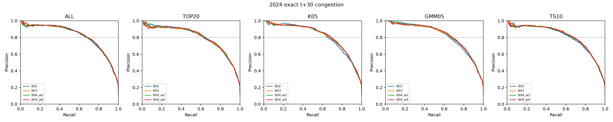
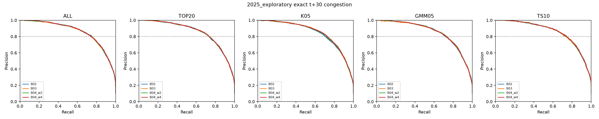
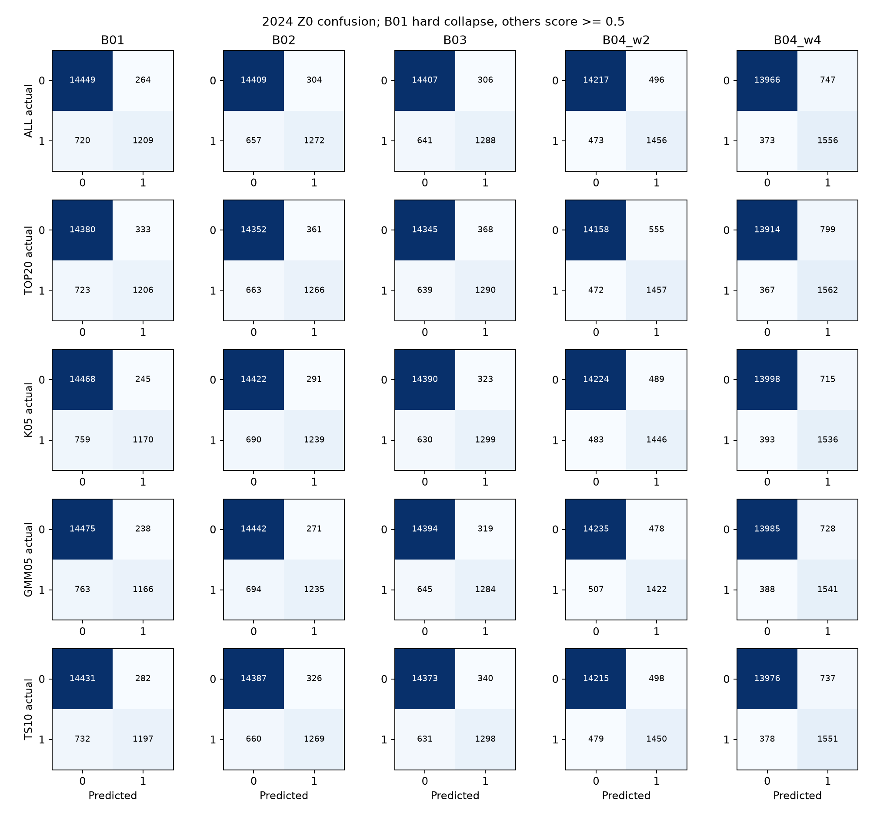
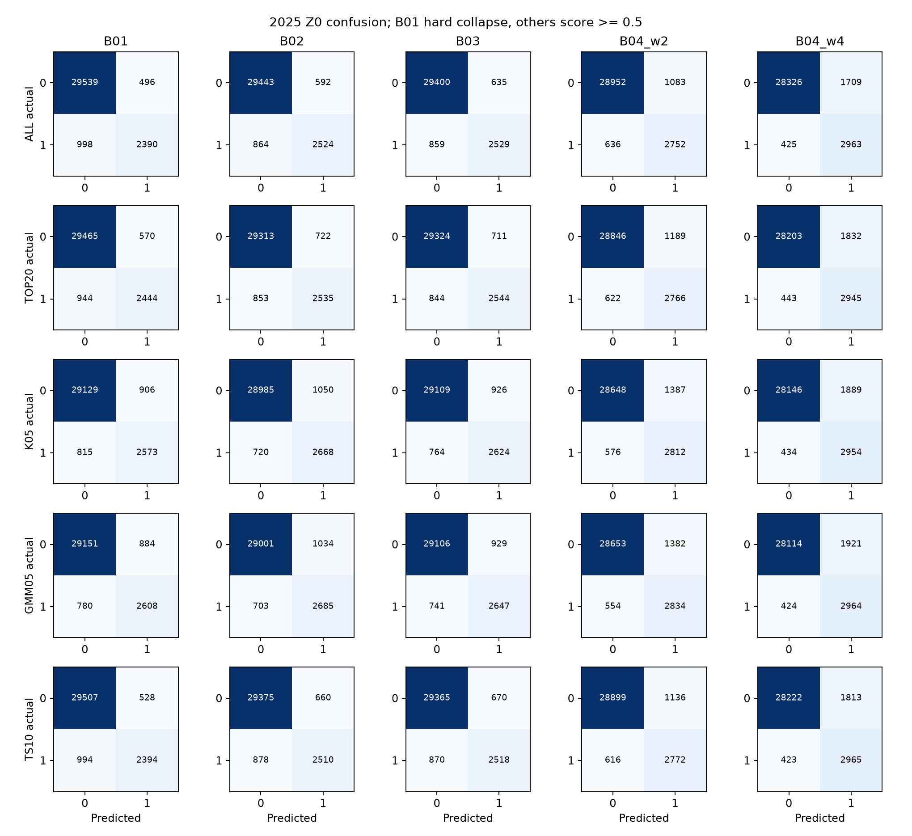

# 二元壅塞 Pilot 實際研究成果 2026年11月25日

本輪完成五種 O 需求配置、2024 三折及 2025 探索性歷史回測，20 個舊三分類模型重現、60 個新二元 LightGBM 訓練，以及 100 份本機逐格預測 checkpoint。正式任務固定為 t+30 分鐘該一時間格是否壅塞。原三分類、來源資料與舊模型均保留。

## 驗收與比較口徑

所有舊模型驗證機率重現至最大絕對差不超過 1e-10，樣本、25 個 VD／時間基礎欄位、O 群需求、train_mask、30 分鐘 embargo 均核對。2024 F1/F2/F3 驗證有效樣本分別 8009/4864/3769，合併 OOF 為 16642 格；2025 為 33423 格、117 個目標研究日。2024 三折研究日數與有效樣本不同，主表是各折指標算術平均，另提供 pooled_2024_OOF.csv；平均漏報數不是總漏報數。F3 原始標籤缺失比例約 27.30%，不得解讀為所有時段均完整驗證。F2 標籤日曆稽核有 4870 格，但按預測起點切分有 4864 格；跨午夜 t 與 target 的邊界不同，沒有強行改寫樣本。

B01 是原三分類 argmax 合併；B02 使用 p1+p2；B03 直接二元；B04_w2/w4 正類樣本權重 2/4，負類 1。B01 與 B02 的排序分數相同，AP 因而相同；硬決策不同。B03/B04 除二元目標與權重外沿用同一組超參數與特徵。加權輸出稱分數，未宣稱校準後真實機率。

## 2024 三折指標算術平均

B01 為既有硬決策，其餘使用預先固定 0.5。precision、recall、F1 為正類，完整正負類、分段與逐折表見 CSV。

| grouping | method | precision_1 | recall_1 | f1_1 | AP | miss | false_alarm | false_alarm_bins_per_day |
|---|---|---|---|---|---|---|---|---|
| ALL | B01 | 0.8320 | 0.6387 | 0.7209 | 0.8306 | 240.0000 | 88.0000 | 4.0162 |
| ALL | B02 | 0.8173 | 0.6708 | 0.7355 | 0.8306 | 219.0000 | 101.3333 | 4.7169 |
| ALL | B03 | 0.8219 | 0.6764 | 0.7405 | 0.8336 | 213.6667 | 102.0000 | 4.6540 |
| ALL | B04_w2 | 0.7595 | 0.7647 | 0.7602 | 0.8338 | 157.6667 | 165.3333 | 7.8479 |
| ALL | B04_w4 | 0.6880 | 0.8153 | 0.7445 | 0.8350 | 124.3333 | 249.0000 | 12.1549 |
| GMM05 | B01 | 0.8382 | 0.6260 | 0.7061 | 0.8308 | 254.3333 | 79.3333 | 4.1501 |
| GMM05 | B02 | 0.8253 | 0.6612 | 0.7252 | 0.8308 | 231.3333 | 90.3333 | 4.7665 |
| GMM05 | B03 | 0.8100 | 0.6818 | 0.7343 | 0.8344 | 215.0000 | 106.3333 | 5.3339 |
| GMM05 | B04_w2 | 0.7537 | 0.7524 | 0.7490 | 0.8366 | 169.0000 | 159.3333 | 8.1997 |
| GMM05 | B04_w4 | 0.6845 | 0.8101 | 0.7397 | 0.8352 | 129.3333 | 242.6667 | 12.4579 |
| K05 | B01 | 0.8307 | 0.6285 | 0.7058 | 0.8258 | 253.0000 | 81.6667 | 4.3445 |
| K05 | B02 | 0.8141 | 0.6625 | 0.7222 | 0.8258 | 230.0000 | 97.0000 | 5.1475 |
| K05 | B03 | 0.8098 | 0.6909 | 0.7386 | 0.8343 | 210.0000 | 107.6667 | 5.4537 |
| K05 | B04_w2 | 0.7545 | 0.7644 | 0.7550 | 0.8363 | 161.0000 | 163.0000 | 8.3267 |
| K05 | B04_w4 | 0.6888 | 0.8080 | 0.7404 | 0.8356 | 131.0000 | 238.3333 | 12.2814 |
| TOP20 | B01 | 0.8095 | 0.6379 | 0.7063 | 0.8260 | 241.0000 | 111.0000 | 4.9913 |
| TOP20 | B02 | 0.8006 | 0.6695 | 0.7228 | 0.8260 | 221.0000 | 120.3333 | 5.5219 |
| TOP20 | B03 | 0.7985 | 0.6802 | 0.7292 | 0.8265 | 213.0000 | 122.6667 | 5.6676 |
| TOP20 | B04_w2 | 0.7430 | 0.7666 | 0.7503 | 0.8284 | 157.3333 | 185.0000 | 8.7822 |
| TOP20 | B04_w4 | 0.6769 | 0.8191 | 0.7384 | 0.8285 | 122.3333 | 266.3333 | 12.9505 |
| TS10 | B01 | 0.8248 | 0.6343 | 0.7125 | 0.8244 | 244.0000 | 94.0000 | 4.3348 |
| TS10 | B02 | 0.8115 | 0.6713 | 0.7303 | 0.8244 | 220.0000 | 108.6667 | 5.0494 |
| TS10 | B03 | 0.8123 | 0.6838 | 0.7386 | 0.8331 | 210.3333 | 113.3333 | 5.0989 |
| TS10 | B04_w2 | 0.7610 | 0.7630 | 0.7583 | 0.8310 | 159.6667 | 166.0000 | 7.8645 |
| TS10 | B04_w4 | 0.6923 | 0.8133 | 0.7451 | 0.8314 | 126.0000 | 245.6667 | 11.9726 |

## 2025 探索性歷史回測

2025 已反覆參與研究探索，不是獨立測試，不以本輪 2025 結果再選模型或調整門檻。

| grouping | method | precision_1 | recall_1 | f1_1 | AP | miss | false_alarm | false_alarm_bins_per_day |
|---|---|---|---|---|---|---|---|---|
| ALL | B01 | 0.8281 | 0.7054 | 0.7619 | 0.8567 | 998 | 496 | 4.2393 |
| ALL | B02 | 0.8100 | 0.7450 | 0.7761 | 0.8567 | 864 | 592 | 5.0598 |
| ALL | B03 | 0.7993 | 0.7465 | 0.7720 | 0.8538 | 859 | 635 | 5.4274 |
| ALL | B04_w2 | 0.7176 | 0.8123 | 0.7620 | 0.8554 | 636 | 1083 | 9.2564 |
| ALL | B04_w4 | 0.6342 | 0.8746 | 0.7352 | 0.8566 | 425 | 1709 | 14.6068 |
| TOP20 | B01 | 0.8109 | 0.7214 | 0.7635 | 0.8516 | 944 | 570 | 4.8718 |
| TOP20 | B02 | 0.7783 | 0.7482 | 0.7630 | 0.8516 | 853 | 722 | 6.1709 |
| TOP20 | B03 | 0.7816 | 0.7509 | 0.7659 | 0.8498 | 844 | 711 | 6.0769 |
| TOP20 | B04_w2 | 0.6994 | 0.8164 | 0.7534 | 0.8500 | 622 | 1189 | 10.1624 |
| TOP20 | B04_w4 | 0.6165 | 0.8692 | 0.7214 | 0.8513 | 443 | 1832 | 15.6581 |
| K05 | B01 | 0.7396 | 0.7594 | 0.7494 | 0.8399 | 815 | 906 | 7.7436 |
| K05 | B02 | 0.7176 | 0.7875 | 0.7509 | 0.8399 | 720 | 1050 | 8.9744 |
| K05 | B03 | 0.7392 | 0.7745 | 0.7564 | 0.8442 | 764 | 926 | 7.9145 |
| K05 | B04_w2 | 0.6697 | 0.8300 | 0.7413 | 0.8432 | 576 | 1387 | 11.8547 |
| K05 | B04_w4 | 0.6100 | 0.8719 | 0.7178 | 0.8467 | 434 | 1889 | 16.1453 |
| GMM05 | B01 | 0.7468 | 0.7698 | 0.7581 | 0.8455 | 780 | 884 | 7.5556 |
| GMM05 | B02 | 0.7220 | 0.7925 | 0.7556 | 0.8455 | 703 | 1034 | 8.8376 |
| GMM05 | B03 | 0.7402 | 0.7813 | 0.7602 | 0.8440 | 741 | 929 | 7.9402 |
| GMM05 | B04_w2 | 0.6722 | 0.8365 | 0.7454 | 0.8470 | 554 | 1382 | 11.8120 |
| GMM05 | B04_w4 | 0.6068 | 0.8749 | 0.7165 | 0.8463 | 424 | 1921 | 16.4188 |
| TS10 | B01 | 0.8193 | 0.7066 | 0.7588 | 0.8514 | 994 | 528 | 4.5128 |
| TS10 | B02 | 0.7918 | 0.7409 | 0.7655 | 0.8514 | 878 | 660 | 5.6410 |
| TS10 | B03 | 0.7898 | 0.7432 | 0.7658 | 0.8509 | 870 | 670 | 5.7265 |
| TS10 | B04_w2 | 0.7093 | 0.8182 | 0.7599 | 0.8527 | 616 | 1136 | 9.7094 |
| TS10 | B04_w4 | 0.6206 | 0.8751 | 0.7262 | 0.8543 | 423 | 1813 | 15.4957 |

## 圖表

## 五個研究問題

1. 合併 Y1/Y2 可移除嚴重程度之間的誤判，但不會自動消除有無壅塞漏報。TOP20 的 2025 B01 精確重現交接矩陣 [[29465,570],[944,2444]]：precision 0.8109、recall 0.7214，仍有 944 格漏報。二元指標的改善不能直接與三分類單類 F1 視為同一任務的增益。
2. 直接二元訓練的增益有限。以 ALL 為例，2024 三折平均 B02→B03：precision 81.73%→82.19%、recall 67.08%→67.64%、AP 0.83057→0.83359。2024 pooled OOF 的 recall 則為 65.94%→66.77%，僅增16格命中；條件於已訓練模型的日期區塊區間為−0.50至2.28個百分點，跨零，不能混用兩種彙總。2025 ALL recall 74.50%→74.65%，但 precision 81.00%→79.93%。分群的方向也不一致，因此尚不足以認定直接重訓全面優於原三分類分數合併；paired_effect.csv 已另比較 B03−B02 及各加權方法−B03。
3. 權重可減少漏報，但代價明顯。ALL 在2024三折平均固定0.5下，B03→權重2→權重4的 recall 為67.64%→76.47%→81.53%，precision為82.19%→75.95%→68.80%，每日平均誤報4.65→7.85→12.15格。施加precision>=0.80約束後，ALL的2024 pooled OOF recall為B03 66.77%（0.5）、權重2 67.24%（0.65）、權重4 65.94%（0.8）；權重2僅比B03多9格命中，未證明穩定優勢。TOP20權重4於固定網格無可行解。threshold_sweep.csv 固定比較 0.20–0.80、間距 0.05；2024 選 precision>=0.80 下最大 recall 的結果是同 OOF 開發探索，不是正式選模後的無偏驗證。正式可比較預先固定的 0.5 表現；折內歷史門檻選擇尚未執行。2024 凍結門檻及 2025 套用結果分別見 frozen_thresholds_2024.json、frozen_threshold_2025_results.csv，不保證 2025 precision 仍達 0.80。
4. Z1 以各折截止前高速>=80 km/h 的有效占有率估計各站 Q95；已與既有 EDA 歷史門檻逐站核對。2024 三折共同有效樣本共有 7 格由原 Y1 正類轉為負類，原 Y2 全保留；2025 共同樣本標籤完全相同。strict 令 2025 額外 848 格成為未知，並非新增壅塞。Z1_available 的 2025 有效樣本與 Z0 相同。各方法在 2025 共同樣本的所有指標差皆為零；2024 敏感度見 label_paired_effect.csv。此為相同已訓練 Z0 模型的評分標籤敏感度，尚未以 Z1 重訓，不依 F1 選壅塞定義。
5. O 分組效益以與 ALL 的成對日期區塊 Bootstrap 比較；無一致性優勢不能寫成某分群一定較好。以下為固定 0.5 的 B03，候選減 ALL 的 2024 pooled OOF 差，非三折平均差。

| grouping | metric | difference | lower_95 | upper_95 |
|---|---|---|---|---|
| TOP20 | precision_1 | -0.0300 | -0.0492 | -0.0118 |
| TOP20 | recall_1 | 0.0010 | -0.0151 | 0.0178 |
| K05 | precision_1 | -0.0072 | -0.0328 | 0.0151 |
| K05 | recall_1 | 0.0057 | -0.0219 | 0.0309 |
| GMM05 | precision_1 | -0.0070 | -0.0298 | 0.0112 |
| GMM05 | recall_1 | -0.0021 | -0.0251 | 0.0224 |
| TS10 | precision_1 | -0.0156 | -0.0297 | -0.0019 |
| TS10 | recall_1 | 0.0052 | -0.0126 | 0.0214 |

## 門檻限制與無可行解

以下門檻只由 2024 pooled OOF 選擇，所有候選規則於讀取 2025 分數前凍結。不可把開發門檻選後的 2024 表現稱為無偏驗證；null/NaN 代表固定網格內沒有 precision>=0.80 的可行門檻，不輸出替代猜測。2025 僅套用這些凍結門檻。

| grouping | method | threshold | feasible_2024 | development_precision | development_recall |
|---|---|---|---|---|---|
| ALL | B02 | 0.5000 | True | 0.8071 | 0.6594 |
| ALL | B03 | 0.5000 | True | 0.8080 | 0.6677 |
| ALL | B04_w2 | 0.6500 | True | 0.8021 | 0.6724 |
| ALL | B04_w4 | 0.8000 | True | 0.8217 | 0.6594 |
| TOP20 | B02 | 0.6000 | True | 0.8182 | 0.6019 |
| TOP20 | B03 | 0.6000 | True | 0.8181 | 0.6107 |
| TOP20 | B04_w2 | 0.7000 | True | 0.8102 | 0.6371 |
| TOP20 | B04_w4 | nan | False | nan | nan |
| K05 | B02 | 0.5000 | True | 0.8098 | 0.6423 |
| K05 | B03 | 0.5000 | True | 0.8009 | 0.6734 |
| K05 | B04_w2 | 0.6500 | True | 0.8084 | 0.6760 |
| K05 | B04_w4 | 0.7500 | True | 0.8037 | 0.6791 |
| GMM05 | B02 | 0.5000 | True | 0.8201 | 0.6402 |
| GMM05 | B03 | 0.5000 | True | 0.8010 | 0.6656 |
| GMM05 | B04_w2 | 0.6500 | True | 0.8175 | 0.6573 |
| GMM05 | B04_w4 | 0.8000 | True | 0.8397 | 0.6407 |
| TS10 | B02 | 0.5500 | True | 0.8143 | 0.6273 |
| TS10 | B03 | 0.5500 | True | 0.8116 | 0.6454 |
| TS10 | B04_w2 | 0.7000 | True | 0.8178 | 0.6397 |
| TS10 | B04_w4 | 0.8000 | True | 0.8207 | 0.6501 |

## 原始嚴重程度分層漏報

以下列 TOP20 2025 範例，分母是該原始真實嚴重程度樣本；其他配置及日型時段見 original_severity_miss.csv。

| method | original_Y | support | miss | miss_fraction |
|---|---|---|---|---|
| B01 | 1 | 1771 | 847 | 0.4783 |
| B01 | 2 | 1617 | 97 | 0.0600 |
| B02 | 1 | 1771 | 775 | 0.4376 |
| B02 | 2 | 1617 | 78 | 0.0482 |
| B03 | 1 | 1771 | 764 | 0.4314 |
| B03 | 2 | 1617 | 80 | 0.0495 |
| B04_w2 | 1 | 1771 | 573 | 0.3235 |
| B04_w2 | 2 | 1617 | 49 | 0.0303 |
| B04_w4 | 1 | 1771 | 414 | 0.2338 |
| B04_w4 | 2 | 1617 | 29 | 0.0179 |

## 事件與限制

label_events.csv 保存可觀測二元連續事件，時間缺口或未知會打斷，標示左右截尾及前 30 分鐘完整無壅塞的 clean onset；label_audit.csv 的時間長度只是觀測持續時間。沒有最低持續時間篩選，不代表事故數。current_state_strata.csv 用事後 Y(t) 區分當時已壅塞、當時無壅塞及未知，僅屬描述性分析，未回填特徵或用作可部署預警閘門。尚未完成新發事件警報命中、窗口型模型或事件每日誤報；t+30 固定格分類與未來30分鐘至少一次壅塞是不同任務。本輪完成前者，後者為後續研究。

配對 Bootstrap 以連續研究日期區塊抽樣 300 次，同區塊兩方法一起抽，保留日內相依，分別處理 2024 pooled OOF 與 2025 探索回測。每日誤報率的重抽日分母包含抽中重複日期的次數。區間條件於已訓練模型，不包含重訓、分群擬合與選門檻的不確定性；多重候選未校正，屬探索性。AP 與負類指標、所有時段日型分層皆保留，無正類或無支持度時需連同 support 判讀；沒有樣本的連假折不虛構成零績效。

全日、14:00–20:00（左含右不含）、其他時段、WEEKEND、LONGHOLIDAY 按目標時間及既有日曆分層。每日誤報為有有效樣本的目標研究日平均五分鐘格數，不是警報事件數或每24小時標準化率。既有 VD 延遲10分鐘、非研究日出發跨午夜尾量、2026尚未驗證等限制仍保留。

本機 DuckDB 原生 DLL 被應用程式政策阻擋，本輪逐字載入原 Engine.block 函式並核對來源 SHA256，只讀快取，不執行資料庫及原始旅次掃描。Word 指定 (2).docx 尚未定位；找到的其他版本未擅自替代。原稿未修改。正式資料與逐格預測僅本機保留，公開與 ZIP 僅含彙總、圖表、程式及可攜來源雜湊。
